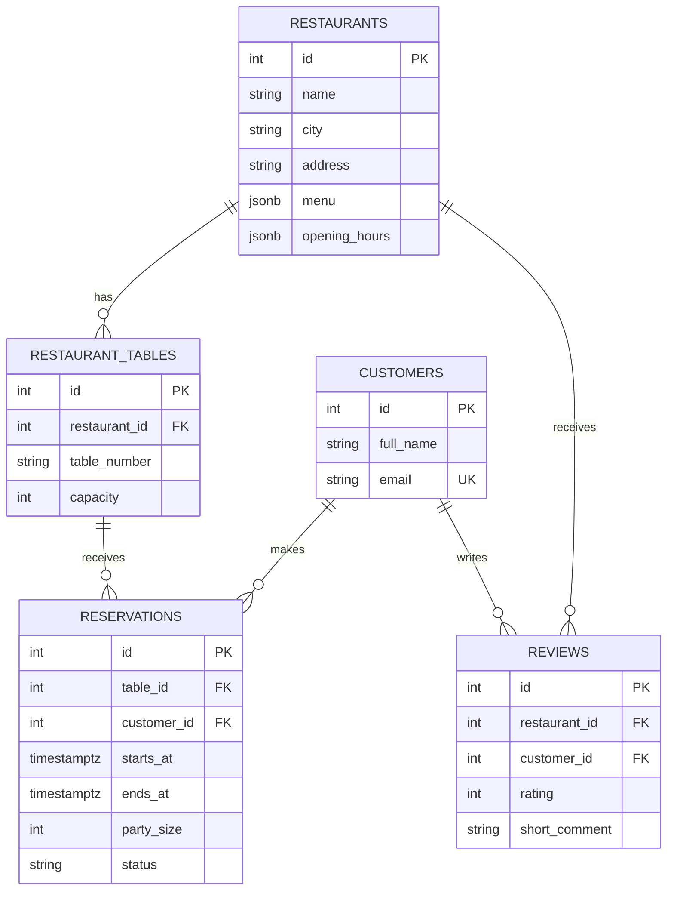

# Restaurant Reservation and Review System

A small Python 3.12 learning project for a database fundamentals assessment. It uses PostgreSQL for structured records, Redis for short-lived availability caching, and MongoDB for long-form customer feedback.

## 1. Requirements

- Python 3.12
- Poetry
- Docker and Docker Compose

## 2. Start the databases

From the project root:

```bash
docker compose up -d
```

The first PostgreSQL startup creates the schema and sample records from `sql/schema.sql` and `sql/sample_data.sql`.

To inspect container status:

```bash
docker compose ps
```

If you change the initialization SQL after the PostgreSQL volume already exists, the scripts do not run again automatically. For a clean learning reset (this deletes local database data), run:

```bash
docker compose down -v
docker compose up -d
```

## 3. Set up Python

```bash
cp .env.example .env
poetry install
poetry run python -m restaurant_app.main
```

You can also use pip:

```bash
python -m venv .venv
source .venv/bin/activate
pip install -r requirements.txt
python -m restaurant_app.main
```

On Windows, activate the virtual environment with `.venv\\Scripts\\activate`.

The CLI uses a sample booking time of 1 November 2026, 18:00–20:00 in the Africa/Kigali timezone. Change the dates in `restaurant_app/main.py` to try another slot.

## 4. Folder structure

```text
restaurant-reservation-system/
├── restaurant_app/
│   ├── __init__.py       # Marks this directory as a Python package
│   ├── config.py         # Reads database settings from environment variables
│   ├── db.py             # PostgreSQL connection pool
│   ├── cache.py          # Redis availability cache
│   ├── reservations.py   # Availability query and atomic booking
│   ├── reviews.py        # PostgreSQL review + MongoDB feedback
│   └── main.py           # Simple interactive command-line interface
├── sql/
│   ├── schema.sql        # Tables, constraints and indexes
│   ├── sample_data.sql   # Example restaurants, tables, customers and reviews
│   └── analytics.sql     # Ranking, CTE, location and EXPLAIN ANALYZE queries
├── tests/
│   └── test_validation.py
├── .env.example
├── .gitignore
├── docker-compose.yml
├── pyproject.toml
├── requirements.txt
└── README.md
```

## 5. ER diagram



## 6. Why this schema is normalized

- `restaurants` contains restaurant facts once.
- `restaurant_tables` contains each table and refers to its restaurant.
- `customers` contains customer details once.
- `reservations` connects one customer to one assigned table and a time range.
- `reviews` connects a customer to a restaurant with a rating.
- Menu and opening-hour data are JSONB because their structure is flexible and the assignment specifically requests JSONB.

The table's capacity is stored once in `restaurant_tables`, not copied into every reservation. Foreign keys prevent reservations and reviews from referring to nonexistent customers or restaurants. Constraints validate positive party sizes, time ranges and ratings.

The MongoDB feedback document includes `postgres_review_id` so a detailed comment can be linked back to the normalized PostgreSQL review. The same review is not fully duplicated in PostgreSQL; only the reporting-friendly score and short comment are stored there.

## 7. Important implementation decisions

### Atomic reservation booking

`book_reservation()` opens a PostgreSQL transaction. It locks suitable table rows with `FOR UPDATE`, checks reservations for overlapping times, inserts a reservation, and commits. If no table is free or an error occurs, the transaction rolls back.

Time intervals overlap when:

```text
existing_start < requested_end AND existing_end > requested_start
```

This permits a reservation to begin exactly when another ends. Locking the table rows makes competing booking transactions wait before checking for conflicts. This is a basic concurrency strategy suitable for this learning project.

### Redis caching

Keys look like:

```text
availability:1:2026-11-01T18:00:00+02:00:2026-11-01T20:00:00+02:00:4
```

The value is a JSON list of available tables and expires after 60 seconds. After a successful booking, availability keys for that restaurant are deleted. PostgreSQL remains the source of truth; Redis failure does not prevent an availability search from running.

### MongoDB feedback

MongoDB stores flexible fields such as detailed feedback text and the timestamp. The relational score stays in PostgreSQL so the ranking query can calculate averages easily. The two databases do not share a transaction; the README documents this simple trade-off.

## 8. Run the SQL analysis

Open a PostgreSQL shell:

```bash
docker compose exec postgres psql -U restaurant_user -d restaurant_db
```

Run the analysis file from your host:

```bash
docker compose exec -T postgres psql -U restaurant_user -d restaurant_db < sql/analytics.sql
```

The ranking query uses `RANK()` partitioned by city. The availability query uses a CTE to identify tables with sufficient capacity, then excludes tables with overlapping confirmed reservations. `EXPLAIN ANALYZE` executes the query and shows actual execution timings and the chosen plan.

## 9. Optimization report template

Run `sql/analytics.sql` and record the actual output from your environment. Do not invent benchmark numbers; results depend on your data and machine.

| Change                                         | Why it may help                                     | How to evaluate                                  |
| ---------------------------------------------- | --------------------------------------------------- | ------------------------------------------------ |
| `(restaurant_id, capacity)` index              | Helps find tables at a restaurant with enough seats | Compare `EXPLAIN ANALYZE` before and after       |
| Partial `(table_id, starts_at, ends_at)` index | Helps conflict checks for confirmed reservations    | Inspect index scans and execution time           |
| `(restaurant_id, rating)` index                | Helps review lookups grouped by restaurant          | Compare query plans with realistic review counts |
| Redis TTL cache                                | Avoids repeated identical availability queries      | Compare cache hit/miss behavior and query counts |

With only a few sample rows PostgreSQL may prefer sequential scans. That is normal; indexes become more useful as tables grow. For geographic distance searches, PostGIS plus a GiST index is the natural next step, but it is intentionally omitted from this basic submission.

## 10. Tests

```bash
poetry run pytest
```

The included tests cover basic time and party-size validation without needing running databases. For full integration testing, also test a successful booking, a conflicting booking, and cache invalidation against the Docker services.

## 11. Known learning-project limitations

- No authentication, payment handling, cancellation CLI, or web API.
- Opening hours and menu JSONB are stored but not used to reject out-of-hours reservations.
- Location search is a simple coordinate bounding box, not an accurate distance calculation.
- PostgreSQL and MongoDB writes are not one distributed transaction.
- Redis cache entries can be briefly stale if another application changes reservations without using this service.
- The CLI uses one fixed demo time until you edit the values in `main.py`.

These limitations keep the project small while demonstrating the main assessment concepts.
